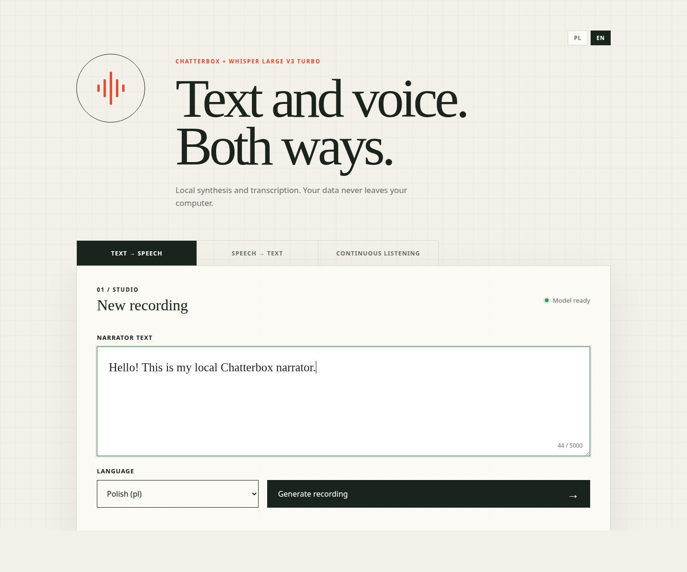

# Local Speech Studio: Chatterbox TTS + Whisper STT

[Polski](README.pl.md) | **English**

A local REST service that converts text into WAV files using
[Chatterbox Multilingual](https://github.com/resemble-ai/chatterbox). It
supports 23 languages, including Polish (`pl`) and English (`en`). The text and
a two-letter language code are passed as JSON.

A second REST service converts audio files and microphone recordings into text
using the local
[Whisper Large V3 Turbo](https://huggingface.co/openai/whisper-large-v3-turbo)
model. The GUI provides both directions in separate tabs.

## Interface preview



## Requirements

- Python 3.11 (recommended by Chatterbox),
- `uv`,
- a compatible CUDA environment when using a GPU.

The model also works on a CPU, but generation is significantly slower. Model
weights are downloaded to the local Hugging Face cache on the first run. All
subsequent speech synthesis is performed locally.

Long texts are automatically split at sentence boundaries. Each fragment is
generated separately, and the service joins them into a single WAV file with
short pauses. This reduces peak GPU memory usage.

The project overrides Chatterbox's older PyTorch pin and uses PyTorch 2.12 with
CUDA 13 to support NVIDIA Blackwell (`sm_120`) GPUs, including the GeForce RTX
5060 Ti. It uses TorchAudio 2.11, whose official release line is compatible
with PyTorch 2.11 and later.

## Tested configuration

The project has been tested on the following hardware and operating system:

- OS: Ubuntu 22.04.5 LTS, Linux kernel `6.8.0-110-generic`,
- CPU: Intel Core i9-14900K (`x86_64`, 32 logical processors),
- GPU: 2 × NVIDIA GeForce RTX 5060 Ti with 16 GB VRAM each,
- NVIDIA driver: `590.48.01`.

## Installation and startup

```bash
uv python install 3.11
uv sync --extra dev --python 3.11
cp .env.example .env
./scripts/start.sh
```

The script starts three separate processes: the GUI (`gui_app.main:app`) on
host `0.0.0.0` and port 8080, the TTS REST service on port 8000, and the STT
REST service on port 8001. It synchronizes the environment and stores separate
PID and log files:

```bash
./scripts/start.sh
```

The processes remain active after the terminal is closed. To stop all three
services:

```bash
./scripts/stop.sh
```

The GUI runs on the computer where `./scripts/start.sh` was executed and, by
default, listens on all its network interfaces (`0.0.0.0`). It is available at
<http://localhost:8080/> on that computer and at
`http://<computer-IP-address>:8080/` from another device on the same network.
Use `GUI_PORT` to change the port and `SPEECH_HOST` to change the listen
address.

The TTS OpenAPI documentation is available at
<http://localhost:8000/docs>, and the STT documentation at
<http://localhost:8001/docs>. The TTS player supports playback speeds from
`0.5×` to `2×`. The STT tab accepts either an audio file or a recording made
directly from the microphone.

The third tab provides continuous microphone listening. Short fragments that
contain speech are checked locally by Whisper. After the wake phrase is
detected, the application records the utterance until approximately 1.4
seconds of silence and displays the result in the GUI.

Set `CHATTERBOX_DEVICE=cuda` or `CHATTERBOX_DEVICE=cpu` to force a device. The
optional `CHATTERBOX_VOICE_PROMPT` variable points to a local WAV voice sample
to clone.

Use `WHISPER_DEVICE` to select the Whisper device. On a computer with two GPUs,
consider using `CHATTERBOX_DEVICE=cuda` and `WHISPER_DEVICE=cuda:1` so that each
model runs on a separate GPU. The first startup downloads approximately 1.6 GB
of Whisper weights.

The default wake phrase is `OK Studio!`. You can set it at startup:

```bash
WHISPER_WAKE_PHRASE="OK Studio!" ./scripts/start.sh
```

You can also change `WHISPER_WAKE_PHRASE` in `.env` or change the default in
`scripts/start.sh`. Restart the services after changing it. Microphone access
requires user permission and a secure context: either `localhost` or HTTPS.

The GUI forwards TTS and STT requests through its own `/api/tts` and `/api/stt`
endpoints. The browser does not connect directly to ports 8000 and 8001, so a
GUI opened from another computer does not try to use that computer's
`localhost`. Upstream service addresses and tab visibility can be configured
at startup. While models are loading, the proxy may temporarily return 502;
the GUI retries health checks and configuration loading every five seconds:

```bash
GUI_TTS_UPSTREAM_URL="http://server:8000" \
GUI_STT_UPSTREAM_URL="http://server:8001" \
GUI_ENABLE_TTS=true \
GUI_ENABLE_STT=true \
GUI_ENABLE_CONTINUOUS=false \
./scripts/start.sh
```

The flags accept `true` or `false`. Continuous listening requires STT to be
enabled. These settings can also be stored in `.env`.

## Usage

Polish:

```bash
curl -X POST http://localhost:8000/v1/speech \
  -H 'Content-Type: application/json' \
  -d '{"text":"Cześć! To jest test polskiego lektora.","language":"pl"}' \
  --output narrator-pl.wav
```

English:

```bash
curl -X POST http://localhost:8000/v1/speech \
  -H 'Content-Type: application/json' \
  -d '{"text":"Hello! This is a test of the English narrator.","language":"en"}' \
  --output narrator-en.wav
```

Transcription with automatic language detection:

```bash
curl -X POST http://localhost:8001/v1/transcriptions \
  -F 'file=@recording.wav' \
  -F 'language=auto'
```

The `language` parameter can be set to `auto`, `pl`, or `en`. The default file
size limit is 100 MB and can be changed with `WHISPER_MAX_UPLOAD_MB`.

## Docker Compose

The project contains three independent images: `gui`, `tts`, and `stt`. The
GPU containers require the NVIDIA driver and NVIDIA Container Toolkit. Start
the complete stack with:

```bash
docker compose up
```

On the first run, Docker automatically builds the images and then downloads
the required models from Hugging Face:

- Chatterbox Multilingual for the TTS service,
- Whisper Large V3 Turbo for the STT service.

There is no need to download or copy the weights manually. The first startup
may take several minutes and requires internet access. Follow model downloads
and startup progress with:

```bash
docker compose logs -f tts stt
```

The GUI runs in the `gui` container. Its internal port 8080 is published on
host port 8080 by default. It is therefore available at
<http://localhost:8080/> on the host and at
`http://<host-IP-address>:8080/` from another device. The GUI container also
acts as a reverse proxy: `/api/tts` routes to `http://tts:8000`, and `/api/stt`
routes to `http://stt:8001` on the Compose network. You do not need to put the
host IP address into the GUI configuration. Changing `GUI_PORT` changes the
host port, not port 8080 inside the container. Check container readiness with:

```bash
docker compose ps
```

The services are ready when the `gui`, `tts`, and `stt` containers have the
`healthy` status. To stop and remove the containers and network:

```bash
docker compose down
```

Chatterbox and Whisper weights are stored in the shared named volume
`local-speech-studio-model-cache`, not in the images. A regular
`docker compose down` preserves this volume, so subsequent `docker compose up`
runs use the local cache instead of downloading the complete models again.
Only an explicit `docker compose down -v` removes the volume; the next startup
after that command downloads the weights again.

By default, TTS uses GPU 0 and STT uses GPU 1. Ports, GPU assignments, and tab
visibility can be overridden at startup:

```bash
GUI_PORT=8080 \
CHATTERBOX_PORT=8000 \
WHISPER_PORT=8001 \
TTS_GPU_ID=0 \
STT_GPU_ID=1 \
GUI_ENABLE_CONTINUOUS=false \
docker compose up
```

The optional `GUI_TTS_UPSTREAM_URL` and `GUI_STT_UPSTREAM_URL` addresses must
be reachable from the `gui` container, not from the browser. The default `tts`
and `stt` names are resolved on the internal Compose network.

Additional endpoints:

- `GET /health` — TTS service status,
- `GET /languages` — supported language codes,
- `GET http://localhost:8001/health` — STT service model and device.

## Tests

```bash
uv run pytest
```

The tests cover Polish and English TTS, long-text splitting, and the STT REST
file upload. They use model test doubles and therefore do not download model
weights.

## Author

Created by **Piotr Stępiński** — a software engineer experimenting with vibe
coding and local AI models, speech synthesis, and voice recognition.
Vibe-coded together with Codex.

## License

This project is distributed under the MIT License:

- [full English license text](LICENSE),
- [full Polish translation](LICENSE.pl.md) — provided for information only.
